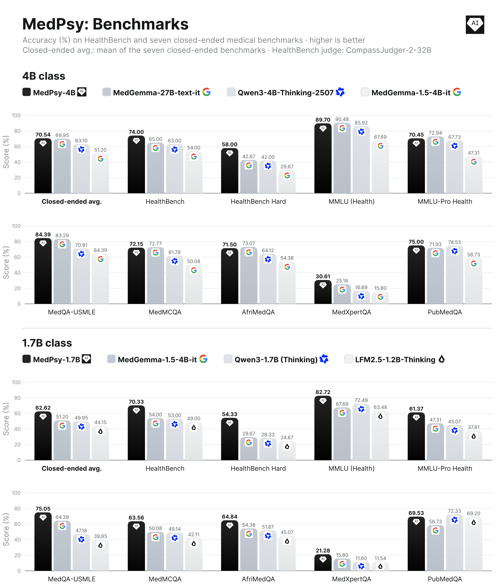
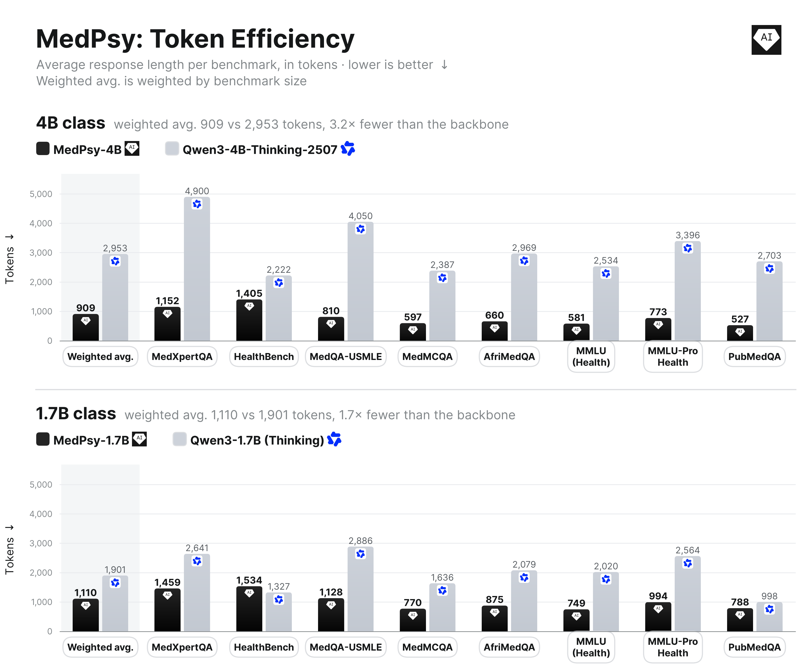

<p align="center">
  <a href="https://arxiv.org/abs/2611.02011"></a>
  
  
  
  
</p>

<h1 align="center">QVAC MedPsy</h1>

<div align="center">
  <b>State-of-the-art small medical language models for efficient edge deployment</b>
</div>

<p align="center">
  <a href="https://arxiv.org/abs/2611.02011">📄 Paper</a> •
  <a href="#-models">📦 Models</a> •
  <a href="#-results">📊 Results</a> •
  <a href="#-quick-start">🚀 Quick start</a> •
  <a href="#-evaluation">🔬 Evaluation</a> •
  <a href="#-intended-use-and-limitations">🧭 Limitations</a> •
  <a href="#-citation">📖 Citation</a> •
  <a href="#-license">📜 License</a>
</p>

<p align="center">
  
</p>

---

**MedPsy** is a family of text-only medical and healthcare language models at **1.7B** and
**4B** parameters, built for private, on-device inference. Both models are post-trained from
Qwen3 backbones with two supervised fine-tuning stages on a synthetic medical corpus and two
reinforcement learning stages with hard-sample mining. The accompanying work was accepted at
NeurIPS 2026.

- **MedPsy-4B** matches **MedGemma-27B-text-it** on seven closed-ended medical benchmarks
  (70.54 vs 69.95) while being 6.75× smaller, and leads it by **+15.33** points on HealthBench Hard.
- **MedPsy-1.7B** beats **MedGemma-1.5-4B-it** by **+11.42** points on closed-ended benchmarks
  and surpasses MedGemma-27B-text-it on HealthBench and HealthBench Hard while being ~16× smaller.
- Both models answer with far fewer tokens than their backbones (**3.2×** shorter for 4B,
  **1.7×** for 1.7B), and **Q4_K_M** GGUF builds stay within one point of BF16 at ~69% less disk.

This repository is the public home of the release. It holds the model overview below and
[`medpsy-eval`](medpsy-eval), the evaluation pipeline that reproduces the paper's numbers.

| Resource | Link |
| -------- | ---- |
| 📑 Paper (NeurIPS 2026) | [arXiv:2611.02011](https://arxiv.org/abs/2611.02011) |
| 📄 Technical report | [huggingface.co/blog/qvac/medpsy](https://huggingface.co/blog/qvac/medpsy) |
| 🤗 Hugging Face collection | [huggingface.co/collections/qvac/medpsy](https://huggingface.co/collections/qvac/medpsy) |
| 💻 Code (evaluation) | [`medpsy-eval/`](medpsy-eval) |
| 📱 On-device runtime | [QVAC SDK](https://qvac.tether.io/dev/sdk/) |

## 📦 Models

| Model | Backbone | Weights (BF16) | GGUF | Target |
| ----- | -------- | -------------- | ---- | ------ |
| 🩺 **MedPsy-4B** | [Qwen3-4B-Thinking-2507](https://huggingface.co/Qwen/Qwen3-4B-Thinking-2507) | [qvac/MedPsy-4B](https://huggingface.co/qvac/MedPsy-4B) | [qvac/MedPsy-4B-GGUF](https://huggingface.co/qvac/MedPsy-4B-GGUF) | Laptops, high-end mobile |
| 📱 **MedPsy-1.7B** | [Qwen3-1.7B](https://huggingface.co/Qwen/Qwen3-1.7B) (thinking mode) | [qvac/MedPsy-1.7B](https://huggingface.co/qvac/MedPsy-1.7B) | [qvac/MedPsy-1.7B-GGUF](https://huggingface.co/qvac/MedPsy-1.7B-GGUF) | Smartphones |

Both are decoder-only `Qwen3ForCausalLM` models in bfloat16, English only, and always reason
before answering (the response contains a reasoning trace that ends with `</think>`).
Architecture details, training data and per-dimension HealthBench tables are on the
Hugging Face model cards.

## 📊 Results

All scores are percentages (higher is better), mean of three runs. MedPsy and Qwen3 models use
`temperature=0.6`, `top_p=0.95`, `top_k=20`, `max_output_tokens=16384`; other models use their
recommended settings.

### Closed-ended medical benchmarks

Answers are generated free-form and the final choice is extracted by an LLM parser
(QwQ-32B). The ranking is stable under two other parsers (Llama-3.3-70B-Instruct and
GPT-OSS-120B) and after decontamination; see the technical report.

| Model | Avg | MMLU Health | AfriMedQA | MMLU-Pro Health | MedMCQA | MedQA (USMLE) | MedXpertQA | PubMedQA |
| ----- | --: | ----------: | --------: | --------------: | ------: | ------------: | ---------: | -------: |
| **MedPsy-4B** | **70.54** | 89.70 | 71.50 | 70.45 | 72.15 | **84.39** | **30.61** | **75.00** |
| MedGemma-27B-text-it | 69.95 | **90.48** | **73.07** | **72.94** | **72.77** | 83.29 | 25.18 | 71.93 |
| Qwen3-4B-Thinking-2507 | 63.10 | 85.92 | 64.12 | 67.73 | 61.78 | 70.91 | 16.69 | 74.53 |
| | | | | | | | | |
| **MedPsy-1.7B** | **62.62** | **82.72** | **64.84** | **61.37** | **63.56** | **75.05** | **21.28** | 69.53 |
| MedGemma-1.5-4B-it | 51.20 | 67.69 | 54.38 | 47.31 | 50.08 | 64.39 | 15.80 | 58.73 |
| Qwen3-1.7B (Thinking) | 49.95 | 72.49 | 51.87 | 45.07 | 49.14 | 47.18 | 11.60 | **72.33** |

Bold marks the best score per column within each size class. MMLU Health is the mean over six
MMLU subjects: anatomy, clinical knowledge, college biology, college medicine, medical
genetics, professional medicine.

### HealthBench

[HealthBench](https://arxiv.org/abs/2505.08775) grades open-ended answers to realistic health
conversations against physician-written rubrics. Hard is the 1,000-conversation subset of the
5,000-conversation Standard set. We report three independent graders; the model ordering is
the same under all of them.

| Model | CompassJudger-2-32B<br>Std / Hard | Llama-3.3-70B<br>Std / Hard | GPT-OSS-120B<br>Std / Hard |
| ----- | :-------------------------------: | :-------------------------: | :------------------------: |
| **MedPsy-4B** | **74.00** / **58.00** | **66.33** / **48.33** | **51.33** / **28.67** |
| **MedPsy-1.7B** | 70.33 / 54.33 | 63.00 / 46.00 | 46.00 / 24.67 |
| MedGemma-27B-text-it | 65.00 / 42.67 | 59.00 / 36.00 | 44.67 / 13.00 |
| Qwen3-4B-Thinking-2507 | 63.00 / 42.00 | 56.00 / 34.00 | 36.67 / 9.33 |
| MedGemma-1.5-4B-it | 54.00 / 29.67 | 48.00 / 24.67 | 31.00 / 2.00 |

CompassJudger-2-32B-Instruct is the primary grader.

### Token efficiency

MedPsy answers with far shorter generations than its backbones, which lowers latency, energy
and KV-cache memory on device. Averages are weighted by benchmark size (lower is better).

| | Backbone | MedPsy | Reduction |
| - | -------: | -----: | --------: |
| 4B (vs Qwen3-4B-Thinking-2507) | 2,953 tokens | **909 tokens** | **3.2×** |
| 1.7B (vs Qwen3-1.7B, thinking) | 1,901 tokens | **1,110 tokens** | **1.7×** |

<p align="center">
  
</p>

### On-device (GGUF)

Each GGUF repository ships an unquantized BF16 export and seven quantized files. **Q4_K_M** is
the recommended deployment format: it cuts the footprint by 68–69% while keeping the aggregate
score within one point of BF16; **Q5_K_M** is the higher-quality option at 64%. Sizes are the
published file sizes. Δ Score is the change in (HealthBench + closed-ended average) / 2
relative to BF16, and *imatrix* marks importance-matrix calibration.

**MedPsy-4B**

| Variant | imatrix | Size (GB) | Δ Size | Δ Score | HealthBench | HealthBench Hard | Closed-ended avg |
| ------- | :-----: | --------: | -----: | ------: | ----------: | ---------------: | ---------------: |
| BF16 | — | 8.83 | — | — | 74 | 58 | 70.54 |
| Q8_0 | no | 4.69 | −47% | −0.15 | 74 | 57 | 70.25 |
| Q5_K_M | yes | 3.16 | −64% | −0.29 | 74 | 58 | 69.96 |
| **Q4_K_M** | yes | **2.72** | **−69%** | **−0.81** | 73 | 56 | 69.92 |
| IQ4_NL | yes | 2.60 | −71% | −1.02 | 73 | 57 | 69.50 |
| IQ4_XS | yes | 2.48 | −72% | −1.08 | 73 | 57 | 69.39 |
| IQ3_M | yes | 2.13 | −76% | −1.50 | 73 | 58 | 68.55 |
| IQ3_XXS | yes | 1.84 | −79% | −5.56 | 69 | 51 | 64.42 |

**MedPsy-1.7B**

| Variant | imatrix | Size (GB) | Δ Size | Δ Score | HealthBench | HealthBench Hard | Closed-ended avg |
| ------- | :-----: | --------: | -----: | ------: | ----------: | ---------------: | ---------------: |
| BF16 | — | 4.07 | — | — | 70 | 54 | 62.62 |
| Q8_0 | no | 2.17 | −47% | 0.00 | 70 | 55 | 62.62 |
| Q5_K_M | yes | 1.47 | −64% | −0.02 | 70 | 55 | 62.58 |
| **Q4_K_M** | yes | **1.28** | **−68%** | **−0.73** | 69 | 52 | 62.16 |
| IQ4_NL | yes | 1.23 | −70% | −1.70 | 69 | 51 | 60.22 |
| IQ4_XS | yes | 1.18 | −71% | −1.79 | 69 | 53 | 60.05 |
| IQ3_M | yes | 1.03 | −75% | −3.58 | 67 | 49 | 58.46 |
| IQ3_XXS | yes | 0.89 | −78% | −12.46 | 59 | 40 | 48.71 |

The 1.7B model degrades roughly twice as fast as the 4B below 4-bit precision, so we do not
recommend sub-4-bit variants of MedPsy-1.7B for medical use.

Matched Q4_K_M local inference on an Apple M5 Pro, over 30 prompts (20 MedQA, 10
MedXpertQA-Text). Time per answer is the median; energy per answer is sustained SoC power
(26.5 W) times median wall time.

| Model | Peak RAM | Decode | Tokens/answer | Time/answer | Energy/answer |
| ----- | -------: | -----: | ------------: | ----------: | ------------: |
| **MedPsy-4B** | 4.29 GB | 83.9 tok/s | **738** | **8.75 s** | **232 J** |
| Qwen3-4B-Thinking-2507 | 4.28 GB | 82.2 tok/s | 2,727 | 34.6 s | 917 J |

Both decode at the same speed; MedPsy-4B is 4× faster per answer and uses 4× less energy
because it writes 73% fewer tokens.

## 🚀 Quick start

MedPsy uses the Qwen3 chat template. For best results, use the evaluation sampling settings
(`temperature=0.6`, `top_p=0.95`, `top_k=20`) and leave room for the reasoning trace.

### Transformers

```python
from transformers import AutoModelForCausalLM, AutoTokenizer

model_name = "qvac/MedPsy-4B"  # or "qvac/MedPsy-1.7B"

tokenizer = AutoTokenizer.from_pretrained(model_name)
model = AutoModelForCausalLM.from_pretrained(model_name, torch_dtype="auto", device_map="auto")

messages = [
    {"role": "user", "content": "What are the common symptoms and first-line treatments for community-acquired pneumonia?"}
]
text = tokenizer.apply_chat_template(messages, tokenize=False, add_generation_prompt=True)
inputs = tokenizer([text], return_tensors="pt").to(model.device)

outputs = model.generate(**inputs, max_new_tokens=8192, do_sample=True,
                         temperature=0.6, top_p=0.95, top_k=20)
response = tokenizer.decode(outputs[0][inputs.input_ids.shape[-1]:], skip_special_tokens=True)
reasoning, _, answer = response.rpartition("</think>")
print(answer.strip())
```

### vLLM

```bash
vllm serve qvac/MedPsy-4B --reasoning-parser qwen3 --max-model-len 32768
```

The server is OpenAI-compatible; the reasoning trace is returned separately from the answer.

### llama.cpp

```bash
hf download qvac/MedPsy-4B-GGUF medpsy-4b-q4_k_m-imat.gguf --local-dir .
llama-cli -m medpsy-4b-q4_k_m-imat.gguf --temp 0.6 --top-p 0.95 --top-k 20
```

### QVAC SDK

For apps, the [QVAC SDK](https://docs.qvac.tether.io/sdk/js-ts-sdk/) runs the same GGUF files
fully on device (desktop, iOS and Android), so patient data never leaves it. Both models ship in
the QVAC model registry, one constant per quantization: `HEALTHCARE_4B_MEDICAL_<QUANT>` and
`HEALTHCARE_1_7B_MEDICAL_<QUANT>` (`Q4_K_M`, `Q5_K_M`, `Q8_0`, `IQ4_XS`, …).

```js
import { loadModel, completion, unloadModel, HEALTHCARE_4B_MEDICAL_Q4_K_M } from '@qvac/sdk';

const modelId = await loadModel({
  modelSrc: HEALTHCARE_4B_MEDICAL_Q4_K_M, // or HEALTHCARE_1_7B_MEDICAL_Q4_K_M on phones
  // The SDK defaults to a 1024-token context, too short for the reasoning trace, and to a
  // generic system prompt; MedPsy's chat template already adds its own persona.
  modelConfig: { ctx_size: 16384, system_prompt: '' },
  onProgress: (p) => process.stderr.write(`\rDownloading ${p.percentage.toFixed(0)}%`),
});

const run = completion({
  modelId,
  history: [{
    role: 'user',
    content: 'What are the common symptoms and first-line treatments for community-acquired pneumonia?',
  }],
  generationParams: { temp: 0.6, top_p: 0.95, top_k: 20, predict: 8192 },
  captureThinking: true, // routes the <think> trace to thinkingDelta events
});

for await (const event of run.events) {
  if (event.type === 'contentDelta') process.stdout.write(event.text);
}

await unloadModel({ modelId });
```

## 🔬 Evaluation

[`medpsy-eval`](medpsy-eval) is the evaluation pipeline behind the numbers above, built on
[Inspect](https://inspect.aisi.org.uk/). The `medpsy` preset pins everything that moves a
score: dataset revisions, prompts, sampling, judge models and revisions, judge prompts and
answer parsers.

| Suite | Benchmarks | Scoring |
| ----- | ---------- | ------- |
| `closed_ended` | MMLU Health (6 subjects), MMLU-Pro Health, MedMCQA, MedQA (USMLE), MedXpertQA, AfriMedQA, PubMedQA | Accuracy; final answer extracted by [QwQ-32B](https://huggingface.co/Qwen/QwQ-32B) |
| `healthbench` | HealthBench (Standard, Hard, Consensus, axes and themes) | Rubric score graded by [CompassJudger-2-32B-Instruct](https://huggingface.co/opencompass/CompassJudger-2-32B-Instruct) |

```bash
cd medpsy-eval
uv sync --extra serve

# 1. Start the model and the suite's judge (vLLM in the background; returns once ready).
CUDA_VISIBLE_DEVICES=0 uv run medpsy-eval serve qvac/MedPsy-4B --port 8000 \
  --reasoning-parser qwen3 --max-model-len 32768
CUDA_VISIBLE_DEVICES=1,2 uv run medpsy-eval serve Qwen/QwQ-32B --port 8001 \
  --revision 976055f8c83f394f35dbd3ab09a285a984907bd0 \
  --reasoning-parser deepseek_r1 --max-model-len 32768 --tensor-parallel-size 2

# 2. Generate, judge and score.
uv run medpsy-eval eval --preset medpsy --suite closed_ended \
  --model vllm/qvac/MedPsy-4B --base-url http://localhost:8000/v1 \
  --judge-base-url http://localhost:8001/v1
```

Benchmark data is downloaded from the Hugging Face Hub at pinned revisions; nothing is
redistributed here. Generations can also be saved with `--no-score` and graded later, by one
or several judges, with `medpsy-eval score`. See [`medpsy-eval/README.md`](medpsy-eval/README.md)
for hardware requirements, serving with plain `vllm serve`, the HealthBench run, scoring with
other judges, outputs and how to read them.

## 🧭 Intended use and limitations

MedPsy is a **starting point for developers and researchers** building healthcare
applications on medical text: research on medical language understanding and reasoning,
prototypes and developer tools, and on-device medical information retrieval in
privacy-sensitive settings. Developers are expected to validate and adapt the models for
their own use case.

> [!WARNING]
> MedPsy is **not a substitute for professional medical judgment**, and its outputs are
> **not a clinical diagnosis**. Always consult a certified physician. These are compact
> models that **will make errors**, and they can sound confident while being wrong,
> incomplete or clinically inappropriate.

- **Hallucinations.** The models can produce plausible but incorrect medical information.
- **English and text only.** Other languages are not validated; images and other modalities
  are not supported.
- **Knowledge cutoff.** The models do not reflect guidelines, approvals or evidence published
  after their training data.
- **Bias.** Biases in synthetic and public source data can carry over. Validate across
  patient populations and clinical contexts.
- **Not for emergencies.** Never use the models as the sole decision-maker in emergency or
  life-threatening situations.
- **Safety testing.** HealthBench covers emergency referrals, context seeking and responding
  under uncertainty, but no dedicated red-teaming has been done. Run your own safety
  evaluation before deployment.

When integrating MedPsy, show users that outputs are AI-generated and not medical advice,
keep qualified professionals in the loop for any diagnosis or treatment, and filter and
monitor outputs in production.

## 📖 Citation

If you use MedPsy or `medpsy-eval` in your research, please cite the
[paper](https://arxiv.org/abs/2611.02011) below.

```bibtex
@inproceedings{vitabile2026medpsy,
  title         = {MedPsy: State-of-the-Art Small Medical Language Models for Efficient Edge Deployment},
  author        = {Vitabile, Davide and Buffa, Alexandro and Nambiar, Akshay and Nazir, Amril},
  booktitle     = {Advances in Neural Information Processing Systems},
  year          = {2026},
  institution   = {Tether Data, S.A. de C.V. d.b.a. Tether AI Research},
  eprint        = {2611.02011},
  archivePrefix = {arXiv},
  primaryClass  = {cs.CL},
  doi           = {10.48550/arXiv.2611.02011},
  url           = {https://arxiv.org/abs/2611.02011}
}
```

## 📜 License

Code and models are licensed separately.

| What | Where | License |
| ---- | ----- | ------- |
| This repository, including `medpsy-eval` | [LICENSE](LICENSE) | [Apache-2.0](https://www.apache.org/licenses/LICENSE-2.0) |
| MedPsy model weights | [Hugging Face collection](https://huggingface.co/collections/qvac/medpsy) | [Apache-2.0](https://www.apache.org/licenses/LICENSE-2.0), for research and educational purposes |

The models are versions of Qwen3-4B-Thinking-2507 and Qwen3-1.7B (Apache-2.0). Their synthetic
training data was generated by [Baichuan-M3-235B](https://huggingface.co/baichuan-inc/Baichuan-M3-235B)
(Apache-2.0) from seeds that include the [Genesis III](https://huggingface.co/datasets/qvac/GenesisIII)
dataset (CC BY-NC 4.0). Benchmark
datasets keep their own licenses and are not redistributed here.

## ©️ Copyright

We will take appropriate action in response to notices of copyright infringement. If you
believe your work has been used or copied in a way that infringes your intellectual property
rights, email [data-apps@tether.io](mailto:data-apps@tether.io) identifying and describing both
the copyrighted work and the allegedly infringing content.
